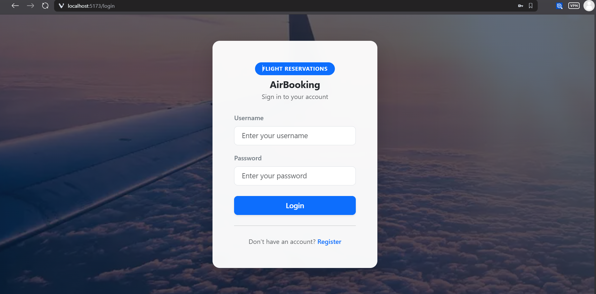
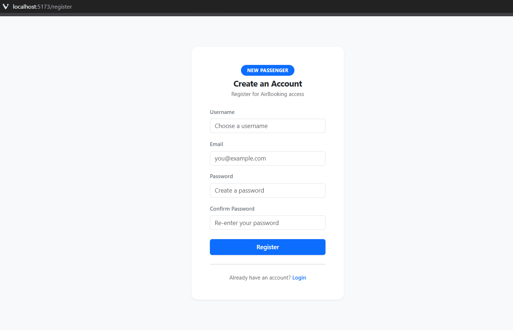
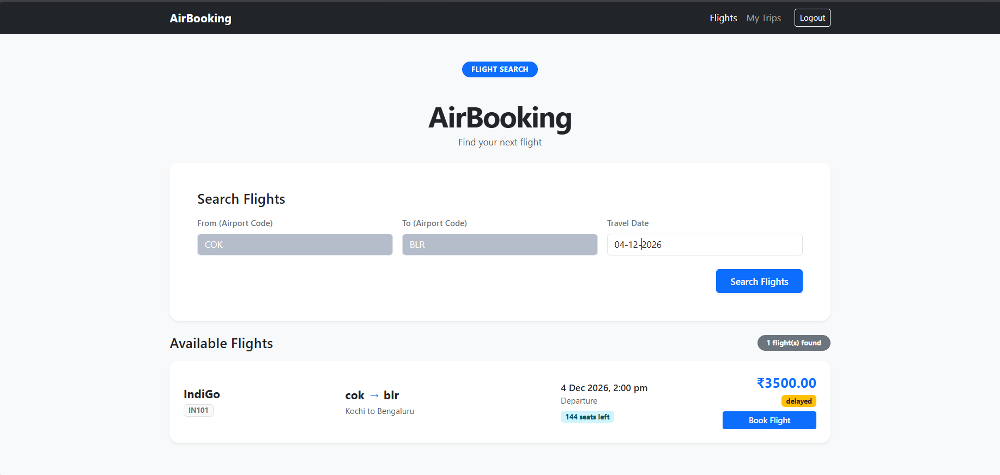
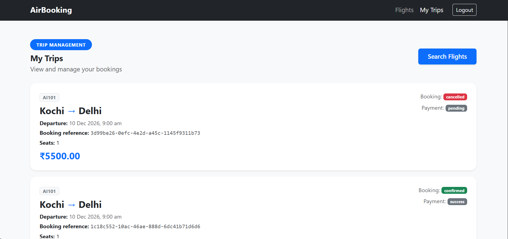
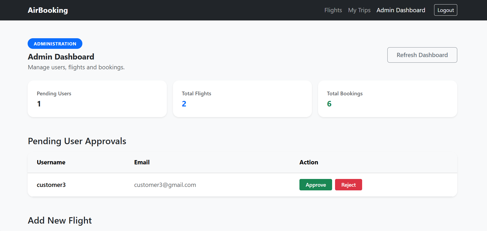
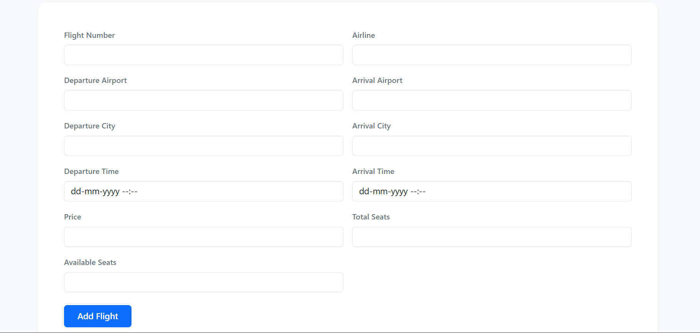
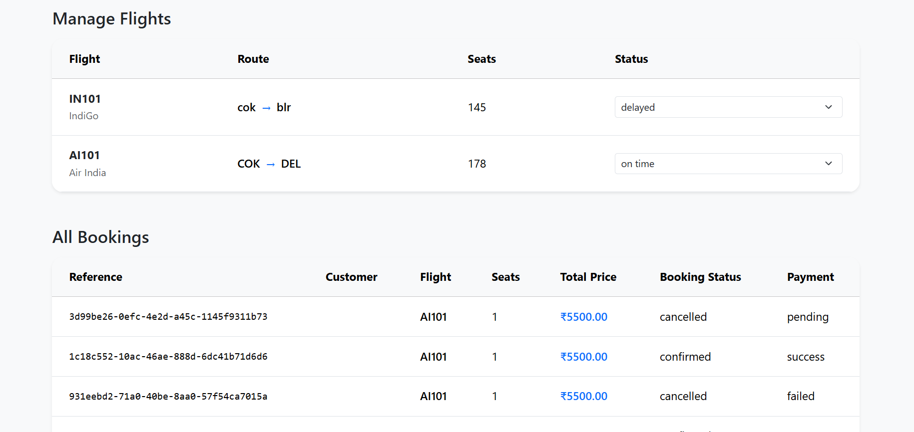

# AirBooking – Full Stack Flight Booking Application

A full-stack flight booking application built using **React** and **Django REST Framework**. The application provides customer registration, admin approval, flight search, booking management, simulated payments, and separate dashboards for customers and administrators.

## Screenshots

The following screenshots demonstrate the main features of the application.

### Authentication




### Customer Dashboard



[Booking](screenshots/booking2.png)



### Admin Dashboard






> **Note:** Update the screenshot filenames above to match the actual image names in your `screenshots` folder.

## Features

### Customer Features
- Customer registration with username, email, and password.
- JWT-based authentication.
- Admin approval required before customer login.
- Search flights by departure airport, arrival airport, and travel date.
- Filter flights based on seat availability.
- View flight details and pricing.
- Book flights with multiple seats.
- Simulated payment with success and failure scenarios.
- View booking history under My Trips.
- Cancel eligible pending bookings.
- Automatic seat availability updates when bookings are created, cancelled, or payment fails.
- Protected customer routes and logout functionality.

### Admin Features
- Admin authentication and role-based dashboard access.
- View pending customer registrations.
- Approve or reject customer accounts.
- Add, view, update, and delete flights.
- Update flight statuses.
- View and manage flight information.
- View customer bookings and booking details.
- Filter bookings by booking and payment status.

## Technology Stack

| Layer | Technologies |
|---|---|
| Frontend | React, Vite, Bootstrap |
| Backend | Python, Django |
| API | Django REST Framework |
| Authentication | JWT, Simple JWT |
| Database | SQLite (development configuration) |
| HTTP Client | Axios |
| Routing | React Router DOM |
| Version Control | Git, GitHub |

## Project Structure

```text
sanjay_airbooking/
│
├── backend/
│   ├── accounts/
│   │   ├── models.py
│   │   ├── serializers.py
│   │   ├── views.py
│   │   └── urls.py
│   │
│   ├── flights/
│   │   ├── models.py
│   │   ├── serializers.py
│   │   ├── views.py
│   │   └── urls.py
│   │
│   ├── bookings/
│   │   ├── models.py
│   │   ├── serializers.py
│   │   ├── views.py
│   │   └── urls.py
│   │
│   ├── config/
│   │   ├── settings.py
│   │   └── urls.py
│   │
│   ├── manage.py
│   └── requirements.txt
│
├── frontend/
│   ├── src/
│   │   ├── components/
│   │   ├── pages/
│   │   ├── services/
│   │   ├── App.jsx
│   │   └── main.jsx
│   │
│   ├── package.json
│   └── index.html
│
├── screenshots/
├── .gitignore
└── README.md
```

## Installation and Setup

### Prerequisites

Make sure the following are installed:

- Python
- Node.js and npm
- Git

### 1. Clone the repository

```bash
git clone https://github.com/Sanjaycruezz/sanjay-airbooking.git
cd sanjay-airbooking
```

### 2. Backend Setup

Navigate to the backend folder:

```bash
cd backend
```

Create a virtual environment:

```bash
python -m venv venv
```

Activate it on Windows PowerShell:

```powershell
.\venv\Scripts\Activate.ps1
```

Install the Python dependencies:

```bash
pip install -r requirements.txt
```

Apply database migrations:

```bash
python manage.py migrate
```

Create an administrator account:

```bash
python manage.py createsuperuser
```

Start the Django development server:

```bash
python manage.py runserver
```

The backend will be available at:

`http://127.0.0.1:8000/`

Django Admin:

`http://127.0.0.1:8000/admin/`

### 3. Frontend Setup

Open another terminal and navigate to the frontend folder:

```bash
cd frontend
```

Install dependencies:

```bash
npm install
```

Start the React development server:

```bash
npm run dev
```

The frontend will be available at:

`http://localhost:5173/`

## Authentication and User Workflow

### Customer Workflow

1. A customer registers through the React registration page.
2. The account is created with a pending approval status.
3. An administrator reviews the registration.
4. Once approved, the customer can log in.
5. The customer searches for available flights.
6. The customer selects a flight and creates a booking.
7. The customer completes the simulated payment process.
8. Booking details can be viewed under My Trips.

### Admin Workflow

1. The administrator logs in using administrator credentials.
2. The application redirects the administrator to the Admin Dashboard.
3. The administrator approves or rejects pending registrations.
4. The administrator manages flights and updates flight statuses.
5. The administrator views customer bookings.

## API Endpoints

All API endpoints use the base URL:

`http://127.0.0.1:8000/api/`

### Authentication APIs

| Method | Endpoint | Description |
|---|---|---|
| POST | `/accounts/register/` | Register a customer |
| POST | `/accounts/login/` | Obtain JWT tokens |
| POST | `/accounts/token/refresh/` | Refresh access token |
| GET | `/accounts/me/` | Retrieve authenticated user profile |

### User Approval APIs

| Method | Endpoint | Description |
|---|---|---|
| GET | `/accounts/admin/pending-users/` | View pending registrations |
| PATCH | `/accounts/admin/users/{id}/approval/` | Approve or reject a customer |

### Flight APIs

| Method | Endpoint | Description |
|---|---|---|
| GET | `/flights/search/` | Search flights |
| GET | `/flights/{id}/` | Retrieve flight details |

Supported search parameters:

- `departure_airport`
- `arrival_airport`
- `date`
- `available`

Example:

```text
GET /api/flights/search/?departure_airport=COK&arrival_airport=BLR&date=2026-12-01&available=true
```

### Admin Flight APIs

| Method | Endpoint | Description |
|---|---|---|
| GET | `/admin/flights/` | List flights |
| POST | `/admin/flights/` | Add a flight |
| GET | `/admin/flights/{id}/` | Retrieve a flight |
| PUT | `/admin/flights/{id}/` | Update a flight |
| DELETE | `/admin/flights/{id}/` | Delete a flight |
| PUT | `/admin/flights/{id}/status/` | Update flight status |

### Booking APIs

| Method | Endpoint | Description |
|---|---|---|
| POST | `/bookings/` | Create a booking |
| GET | `/bookings/my/` | View the current user's bookings |
| GET | `/bookings/{id}/` | Retrieve booking details |
| POST | `/bookings/{id}/payment/` | Process simulated payment |
| POST | `/bookings/{id}/cancel/` | Cancel an eligible booking |

### Admin Booking APIs

| Method | Endpoint | Description |
|---|---|---|
| GET | `/admin/bookings/` | View all bookings |
| GET | `/admin/bookings/{id}/` | Retrieve booking details |

**Authentication:** Protected endpoints require a JWT access token in the request header:

```text
Authorization: Bearer <access_token>
```

## Additional Features and Implementation Highlights

Beyond the basic flight search and booking workflow, the application includes:

- Role-based access control for customers and administrators.
- Admin approval workflow for new customer registrations.
- Automatic seat availability updates during booking and cancellation.
- Transaction-based booking creation and payment processing.
- Booking reference generation using UUID.
- Protection against duplicate payment processing.
- Prevention of cancellation after flight departure.
- Separate customer and administrator dashboards.
- Automatic redirection based on the authenticated user's role.

## Current Limitations and Future Improvements

The following features are planned for further development:

- Integration with a live flight-status provider such as AirLabs or OpenSky.
- Asynchronous email notifications using Celery and Redis when customer accounts are approved.
- Integration with a real payment gateway.
- Production deployment with a production database and environment-based configuration.

**Payment note:** The current payment functionality is simulated for demonstration purposes and does not process real financial transactions.

## Demo Video

**Application demonstration:** [Insert your demo video link here]

## Repository

GitHub: https://github.com/Sanjaycruezz/sanjay-airbooking

---

**Developed by Sanjay M**

Full Stack Developer | React | Django REST Framework | Python